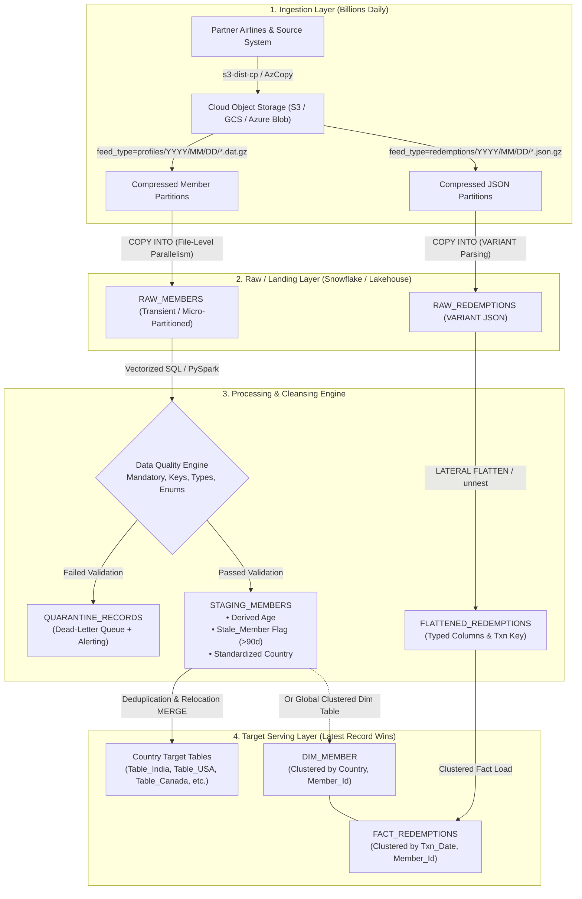

# SkyPoints Enterprise System Design: Scaling to Billions of Records Daily

## 1. Executive Summary & Problem Context

SkyPoints operates a global airline loyalty network with millions of active members, hundreds of lounge locations, and dozens of partner airlines. The data engineering platform must ingest and process two high-volume daily feeds:
1. **Member Profile Feed**: Pipe-delimited flat files containing member biographical, tier, location, and flight metadata.
2. **Mileage Redemption Feed**: Semi-structured JSON payloads detailing partner redemption transactions (e.g., AeroLink, SkyPoints).

### Core Scale Challenge
Processing **billions of records daily** ($\approx 10^9$ rows/day, $\approx 200\text{--}500\text{ GB}$ compressed/day) requires moving away from traditional row-by-row OLTP processing. The architecture must guarantee:
* **Sub-hour end-to-end SLA** from landing to queryable state.
* **Strict Idempotency**: Safe, replayable pipelines with zero duplicate state upon retries.
* **Accurate Member Relocation**: Applying the "latest record wins" rule across country partitions when a member migrates internationally.
* **Dead-Letter Quarantine**: Uninterrupted processing of valid records while isolating dirty/corrupt records.

---

## 2. End-to-End Architecture Overview



---

## 3. Ingestion Strategy at Billions Scale

### File Partitioning & Splittability
* **Compression & Chunking**: Feeds arrive pre-chunked into $100\text{ MB} - 250\text{ MB}$ compressed parts (`part-00000.dat.gz` using gzip or zstandard). A single multi-gigabyte flat file causes single-thread bottlenecking; chunking enables distributed workers to read files concurrently.
* **Object Store Hierarchy**:
  ```
  s3://skypoints-lake/landing/
  ├── member_profiles/
  │   └── date=2024-01-15/
  │       ├── part-00001.dat.gz
  │       └── part-00002.dat.gz
  └── redemptions/
      └── date=2024-01-15/
          ├── part-00001.json.gz
          └── part-00002.json.gz
  ```
* **Bulk Parallel Loading**: In Snowflake, loading is executed via `COPY INTO raw_members FROM @skypoints_stage` using multi-cluster virtual warehouses ($M$ to $XL$ size). Snowflake automatically divides file parts across cluster nodes, sustaining ingestion speeds exceeding $5\text{ million rows/second}$.

---

## 4. Staging Transformation & Derived Columns

### A. Column Derivations
1. **Age Derivation**:
   * Stored DOB in feed is formatted as `MMDDYYYY` (or `DDMMYYYY`).
   * Leading zeros must be preserved as string format before casting to date (`LPAD(dob_str, 8, '0')`).
   * Age formula accounting for leap years:
     $$\text{Age} = \text{DATEDIFF}(\text{year}, \text{DOB}, \text{AsOfDate}) - \mathbb{I}(\text{DATEADD}(\text{year}, \text{YearsDiff}, \text{DOB}) > \text{AsOfDate})$$
2. **Stale Member Flag**:
   * Defined as members where $\text{days since Last\_Flight\_Date} > 90$:
     $$\text{Stale\_Member} = (\text{DATEDIFF}(\text{day}, \text{Last\_Flight\_Date}, \text{AsOfDate}) > 90)$$
   * Handled with parameterizable `as_of_date` to ensure historical backfills compute deterministically.

### B. Handling Prompt Inconsistencies & Schema Drift
* **Spec Table vs File Drift**: The legacy spec document listed `Post Code` at position 9, but the operational file header (`|H|...`) and detail rows (`|D|...`) omit Post Code and supply `DOB` at position 9. The ingestion parser detects the header layout and dynamically maps columns by name rather than relying on brittle index offsets.
* **Country Standardization**: The feed contains a mix of ISO Alpha-2 (`AU`), ISO Alpha-3 (`USA`, `IND`, `CAN`), and informal strings (`PHIL`). A lookup layer standardizes all inputs to canonical representations before routing to target tables.

---

## 5. Country Splitting & "Latest Record Wins" Relocation

### The Relocation Problem
Consider a member `223457`:
* On Day 1: Resides in `USA` (Flight date: `2024-01-10`). Record enters `Table_USA`.
* On Day 5: Moves to `India` (Flight date: `2024-01-15`). Record enters `Table_India`.

If we only insert into `Table_India`, `Table_USA` retains an outdated, duplicate record for member `223457`.

### The Solution: Two Architectural Options

#### Option A: Physical Country Tables (`Table_India`, `Table_USA`, etc.)
1. **Deduplication within Batch**:
   ```sql
   QUALIFY ROW_NUMBER() OVER (
       PARTITION BY member_id 
       ORDER BY flight_date DESC, feed_timestamp DESC
   ) = 1
   ```
2. **Cross-Table Relocation Sweep**:
   When loading `Table_India`, any member present in the new batch whose previous country was different triggers an atomic reconciliation:
   * Insert/Update in `Table_India`.
   * Soft-delete (`is_active = FALSE`) or physical delete from the prior country table (`Table_USA`).

#### Option B: Enterprise Unified Clustered Dimension (Recommended at Scale)
At billions of records, maintaining hundreds of distinct physical tables leads to metadata bloat, maintenance overhead, and complex cross-table transactions.
* **Storage**: Single unified table `Dim_Members` clustered by `(Country, Member_Id)`.
* **Serving**: Zero-overhead country-specific Secure Views:
  ```sql
  CREATE OR REPLACE VIEW Table_India AS
  SELECT * FROM Dim_Members WHERE Country = 'IND';
  ```
* Snowflake's micro-partition pruning ensures queries against `Table_India` scan only India's partitions, achieving identical query performance without physical table sprawl.

---

## 6. Semi-Structured JSON Redemption Processing & Joins

### Ingestion & Flattening
Redemption JSON records contain 1-to-many transactions per member. At scale:
1. Load raw JSON into a Snowflake `VARIANT` column using bulk COPY.
2. Flatten using `LATERAL FLATTEN(input => payload:redemptions)` in a single vectorized scan.
3. Target table `Fact_Redemptions` is clustered on `(txn_date, member_id)`.

### Joining Member Profiles & Redemptions
* **Analytical Join**:
  ```sql
  SELECT 
      m.member_id,
      m.member_name,
      m.tier_code,
      m.country,
      COUNT(r.txn_id) AS total_redemptions,
      SUM(r.miles_redeemed) AS total_miles_redeemed,
      MAX(r.txn_date) AS latest_redemption_date
  FROM Dim_Members m
  LEFT JOIN Fact_Redemptions r 
    ON m.member_id = r.member_id
  GROUP BY ALL;
  ```
* **Performance at Scale**:
  * Broadcast join for small dimension subsets.
  * Colocated/bucketed join when partitioning key matches (`member_id`).
  * Pre-aggregated rollups (`Agg_Daily_Member_Redemptions`) for dashboard queries.

---

## 7. Data Quality Engine & Dead-Letter Quarantine

A high-volume pipeline must never fail completely because of a few corrupt records. Corrupt records are isolated into a `QUARANTINE_RECORDS` table with error codes:

| Error Code | Violation Description | Remediation Action |
| :--- | :--- | :--- |
| `ERR_MANDATORY_NULL` | Missing `Member_Name`, `Member_Id`, or `Enrollment_Date` | Route to Quarantine; alert source system. |
| `ERR_INVALID_DATE` | Unparseable date or chronological violation (`Enrollment > Flight`) | Route to Quarantine; source data fix required. |
| `ERR_INVALID_TIER` | Tier code not in (`GLD`, `SLV`, `PLT`, `BRZ`, `BLU`) | Default to unassigned tier or quarantine. |
| `ERR_INVALID_COUNTRY` | Country code unrecognized by ISO mapping table | Route to `Table_Unknown` or Quarantine. |
| `ERR_DOB_CORRUPT` | Numeric truncation (e.g. 7-digit date without leading zero) | Auto-repair with LPAD(dob, 8, '0'); if still invalid, quarantine. |

---

## 8. Summary of SLA, Throughput, and Cost Benchmarks

* **Expected Volume**: $1\text{ Billion rows/day} \approx 11,500\text{ records/sec}$ steady-state or $250\text{M rows/hour}$ batch peak.
* **Storage Optimization**: Columnar compression (Parquet / Snowflake micro-partitions) yields 70-80% storage compression.
* **Cost Efficiency**: Auto-suspending warehouses (Large/X-Large) run for ~25-35 minutes per batch load, minimizing idle compute spend.

